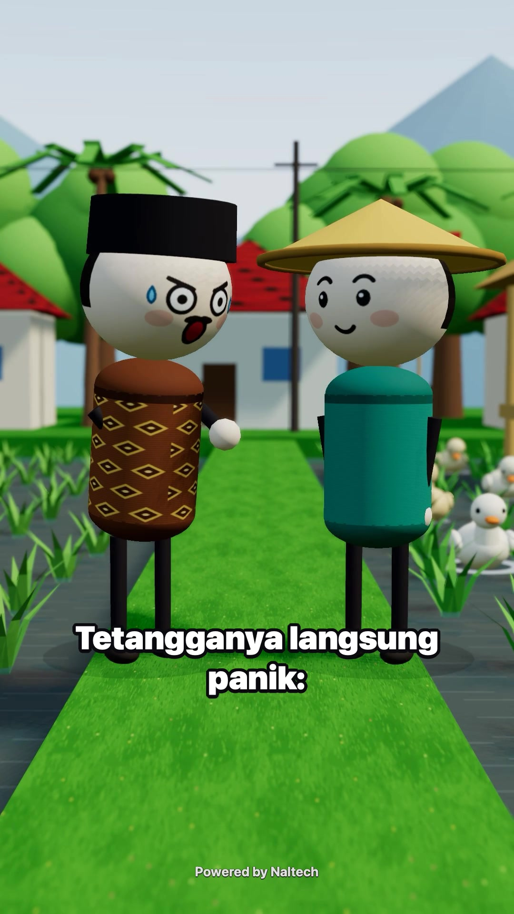
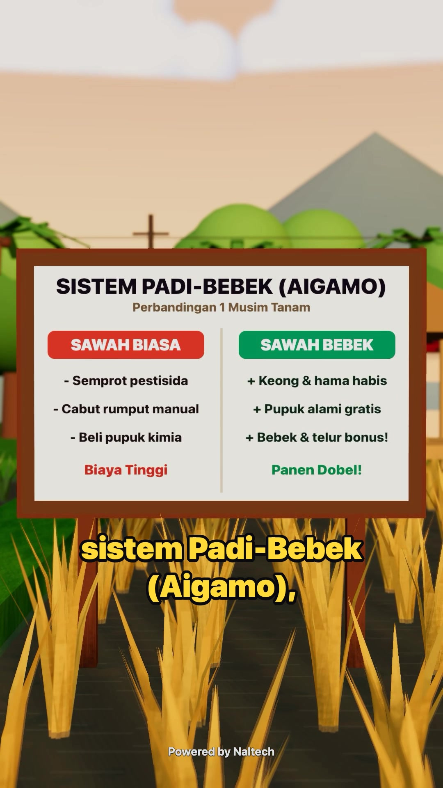
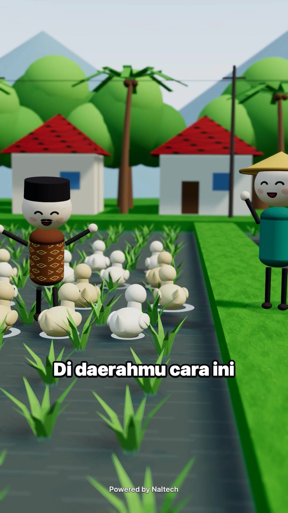
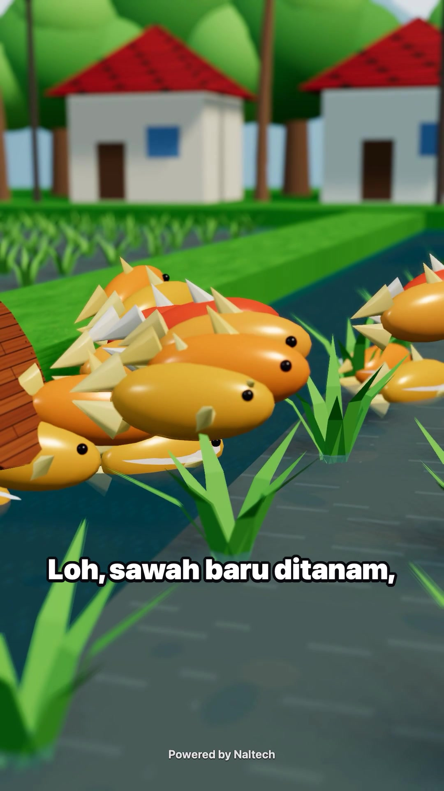
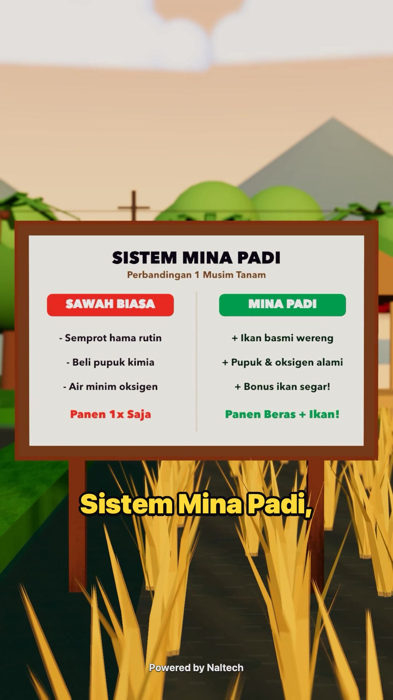
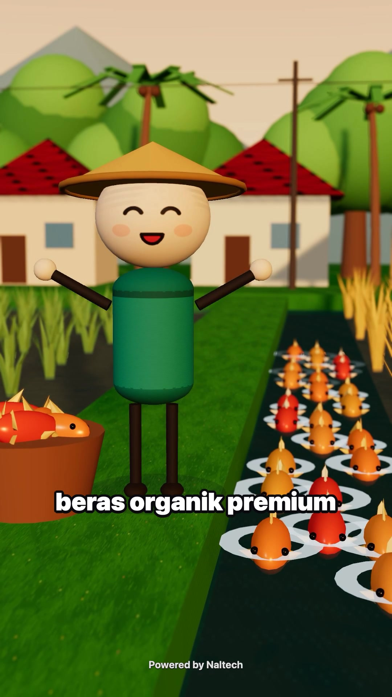
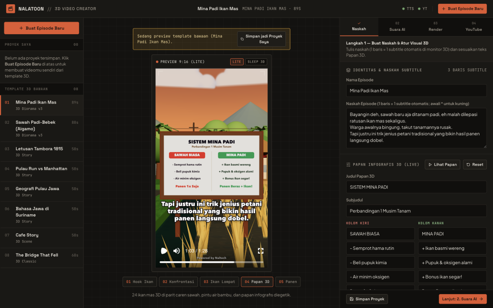

# Nalatoon 3D Motion Graphics Studio

Proyek terpadu untuk memproduksi video **3D Diorama Motion Graphics vertikal (9:16, 1080×1920, 30 fps)** untuk YouTube Shorts / Reels / TikTok menggunakan **Remotion + React Three Fiber + Three.js**, lengkap dengan:

- **3D Diorama Engine** — karakter & lingkungan 3D prosedural (PBR lighting, depth-of-field bokeh, animasi kamera halus, seamless auto-loop).
- **Local AI Voiceover (Gratis & Unlimited)** — narasi Bahasa Indonesia lokal di Apple Silicon via `mlx-audio` + **Qwen3-TTS** (mendukung *VoiceDesign* santai maupun *Voice Cloning*).
- **Subtitle & Watermark Burner** — pembakar teks pop-in + watermark berbasis Swift AVFoundation (macOS).
- **YouTube Shorts Auto-Uploader** — uploader headless YouTube Data API v3 dengan dukungan antrean harian & penjadwalan otomatis di server YouTube (`publishAt`).

---

## Preview Hasil Render (3D Diorama 9:16)

### Episode 1 — Sistem Padi-Bebek / Aigamo (`PadiBebekShort`)
| Konfrontasi Karakter 3D | Infografis Papan 3D Diegetik | Selebrasi Sawah & Bebek 3D |
| :---: | :---: | :---: |
|  |  |  |

### Episode 2 — Sistem Mina Padi Ikan Mas (`MinaPadiShort`)
| Hook Ikan Mas 3D di Sawah | Infografis Papan 3D Diegetik | Panen Beras Organik + Ikan |
| :---: | :---: | :---: |
|  |  |  |

---

## Prasyarat & Kompatibilitas OS

Proyek ini mendukung **macOS (Apple Silicon & Intel), Windows 10/11, dan Linux/VPS**:

| Komponen | macOS Apple Silicon (M1–M4) | Windows 10/11 | Linux / VPS | Intel Mac |
| :--- | :---: | :---: | :---: | :---: |
| **Web Studio UI (`npm run ui`)** | ✅ Penuh | ✅ Penuh | ✅ Penuh | ✅ Penuh |
| **Render 3D MP4 (`npm run render:*`)** | ✅ GPU (`angle`) | ✅ GPU (`angle`) | ✅ GPU / CPU (`swiftshader`) | ✅ GPU (`angle`) |
| **YouTube Auto-Uploader** | ✅ Penuh | ✅ Penuh | ✅ Penuh | ✅ Penuh |
| **Voiceover AI (`Edge TTS`)** | ✅ Gratis | ✅ Gratis | ✅ Gratis | ✅ Gratis |
| **Voiceover Lokal GPU (`Qwen3-TTS MLX`)** | ✅ Offline GPU | ⚠️ Gunakan `Edge TTS` | ⚠️ Gunakan `Edge TTS` | ⚠️ Gunakan `Edge TTS` |

### Spesifikasi Hardware Minimum
- **Node.js & npm**: Node.js 18+ (wajib untuk Web UI & render 3D Remotion)
- **Python**: Python 3.11+ (opsional, untuk Voiceover AI & YouTube auto-uploader)
- **RAM**: Minimal **8 GB** (aktifkan mode `LITE` di Web UI dan `REMOTION_CONCURRENCY=1` saat render); **16 GB+** direkomendasikan
- **GPU**: GPU terintegrasi (*Intel / AMD / Apple Silicon / NVIDIA*) cukup; di VPS Linux tanpa GPU gunakan `REMOTION_GL=swiftshader`
- **FFmpeg**: Otomatis ikut terpasang via `@remotion/compositor` saat `npm install` (atau install sistem via `brew` / `winget` / `apt`)

---

## 1. Instalasi Awal

### A. Clone & Install Dependencies Node.js (macOS / Windows / Linux)
```bash
git clone <URL_REPO_KAMU>
cd nalatoon-motion-3d
npm install
```

### B. Cek TypeScript & Anti-AI-Slop Linter (Opsional)
```bash
npm run typecheck
npm run lint:slop
```

### C. Install Dependencies Python (Opsional: Voiceover & YouTube Uploader)
**macOS / Linux:**
```bash
python3 -m venv .venv
source .venv/bin/activate
pip install -r requirements.txt

# Tambahan khusus macOS Apple Silicon (M1-M4) untuk Qwen3-TTS lokal offline:
pip install -r requirements-mac-mlx.txt
```

**Windows (PowerShell):**
```powershell
python -m venv .venv
.venv\Scripts\Activate.ps1
pip install -r requirements.txt
```

### D. Siapkan Konfigurasi Lokal (Opsional: untuk Auto-Upload YouTube)
```bash
cp .env.example .env
```
Edit `.env` sesuai ID channel dan folder lokal Anda (file `.env` dan folder `secrets/` otomatis di-ignore oleh `.gitignore`).

---

## 2. Jalankan Nalatoon Studio Web UI (Rekomendasi — All-in-One)

Selain lewat terminal, proyek ini dilengkapi **Studio Web App lokal (`web-studio/`)** dengan Live 3D Preview (`@remotion/player`), Editor Papan 3D real-time, Voiceover AI (`Qwen3-TTS`), 1-Click Render MP4, dan YouTube Shorts Scheduler:

```bash
npm run ui
```

Lalu buka **`http://127.0.0.1:5173`** di browser.



Fitur & Alur Kerja 4 Langkah di dalam Web UI:
- **`+ Buat Episode Baru` (Proyek Saya vs Template Bawaan)** — pilih salah satu dari 8 template dunia 3D dan simpan sebagai proyekmu sendiri di `PROYEK SAYA` tanpa menimpa contoh bawaan.
- **Langkah 1: Naskah & Visual 3D** — tulis naskah cerita (1 baris = 1 subtitle otomatis ber-timing di monitor 3D), edit teks Papan Infografis 3D secara live, atur exposure kamera & watermark.
- **Langkah 2: Suara AI** — naskah Langkah 1 otomatis tersinkron; pilih `Qwen3 1.7B (Mac)`, `Clone (Mac)`, atau `Edge TTS (All OS)` lalu pasang audio ke proyek.
- **Langkah 3: Render MP4** — ringkasan pre-render (Template + Subtitle + Audio), pilih kualitas CRF & WebGL (`ANGLE` / `SwiftShader`), render Full HD 1080×1920 dengan progress bar live.
- **Langkah 4: Upload YouTube** — kirim MP4 hasil Langkah 3 ke folder antrean (`caption.txt` otomatis) dan jadwalkan publish otomatis jam `19:00 WIB`.
- **Hemat RAM (`LITE` + `SLEEP 3D`) & Anti-AI-Slop** — preview ringan default `LITE` (Render MP4 tetap 100% HD), tombol `SLEEP 3D` untuk 0 MB VRAM, mengikuti kontrak [web-studio/DESIGN.md](web-studio/DESIGN.md) dan dijaga otomatis lewat `npm run lint:slop`.

---

## 3. Preview Interaktif di Remotion Studio (Opsional)

Jalankan studio untuk melihat animasi 3D secara langsung, scrub timeline per frame, dan cek komposisi sebelum render:

```bash
npm run studio
```

Buka URL lokal yang muncul di terminal (biasanya `http://localhost:3000`), lalu pilih salah satu komposisi episode di sidebar kiri.

### Daftar Komposisi Episode

| Composition ID | Tema / Gaya | Perintah Render Cepat |
| :--- | :--- | :--- |
| `PadiBebekShort` | 3D Diorama v3 — Sistem Padi-Bebek (*Aigamo*) | `npm run render:padibebek` |
| `MinaPadiShort` | 3D Diorama v3 — Sistem Mina Padi Ikan Mas | `npm run render:minapadi` |
| `TamboraShort` | 3D Story — Letusan Gunung Tambora 1815 | `npm run render:tambora` |
| `PulauRunShort` | 3D Story — Pulau Run vs Manhattan | `npm run render:pulaurun` |
| `JawaShort` | 3D Story — Sejarah & Geografi Jawa | `npm run render:jawa` |
| `BahasaJawaShort` | 3D Story — Bahasa Jawa di Suriname | `npm run render:bahasajawa` |
| `CafeShort` | 3D Story — Cerita Kafe | `zsh scripts/render/render_short.sh CafeShort` |
| `BridgeShort` | 3D Story — Jembatan yang Runtuh oleh Langkah Tentara | `zsh scripts/render/render_short.sh BridgeShort` |

---

## 3. Cara Render Video 3D ke MP4

### Menggunakan Shortcut npm
```bash
npm run render:padibebek
# atau
npm run render:minapadi
```
Hasil video mentah akan tersimpan di folder `./out/<CompositionId>.mp4`.

### Menggunakan Script Generik Lintas OS (macOS / Windows / Linux)
```bash
# Format: node scripts/render/render_short.mjs <CompositionId> [path_output.mp4]
node scripts/render/render_short.mjs MinaPadiShort ./out/minapadi.mp4

# Untuk VPS Linux tanpa GPU (CPU SwiftShader) atau laptop RAM 8GB:
REMOTION_CONCURRENCY=1 REMOTION_GL=swiftshader \
  node scripts/render/render_short.mjs MinaPadiShort ./out/minapadi.mp4
```

- `REMOTION_CONCURRENCY`: jumlah tab Chromium paralel (disarankan `2` agar RAM/GPU stabil).
- `REMOTION_CRF`: kualitas video H.264 (`18` = sangat tajam, `22` = ukuran file lebih kecil).

---

## 4. Cara Generate Voiceover AI Lokal (Gratis di Apple Silicon)

Proyek ini memakai **Qwen3-TTS** melalui `mlx-audio` (100% lokal di GPU Mac, gratis tanpa batas kuota).

Aktifkan virtualenv Python terlebih dahulu:
```bash
source .venv/bin/activate
```

### Mode 1: `VoiceDesign` (Rekomendasi — Gaya Storytelling Santai Tanpa Rekam Suara)
Model `Qwen3-TTS-12Hz-1.7B-VoiceDesign-8bit` akan diunduh otomatis saat pemakaian pertama (~2,4 GB, lalu tersimpan di cache):
```bash
MLX_MODE=design zsh scripts/audio/clone_voice_mlx.sh \
  "Bayangin deh, sawah baru aja ditanam, eh malah dilepasi ratusan bebek sekaligus. Kenapa bisa gitu?" \
  ./out/tts
```

### Mode 2: `Base` Voice Cloning (Memakai Rekaman Suara Referensi Sendiri)
Siapkan 1 rekaman suara jernih 8–12 detik (`voice_ref.wav`) beserta transkrip teks persisnya (`voice_ref.txt`), lalu jalankan:
```bash
MLX_MODE=clone zsh scripts/audio/clone_voice_mlx.sh \
  "Teks narasi episode Anda di sini..." \
  ./out/tts \
  ./assets/brand/voice_ref.wav \
  ./assets/brand/voice_ref.txt
```

### Pipeline Audio Penuh per Episode (Narasi + SFX + Subtitle JSON/SRT)
Script contoh untuk membangun audio master + timing subtitle otomatis tersedia di:
- `scripts/audio/build_padibebek_v3_qwen3.py`
- `scripts/audio/build_minapadi_audio.py`
- `scripts/audio/build_subtitles.py`

---

## 5. Cara Burn Subtitle & Gabungkan Audio (macOS)

Setelah punya video mentah (`video_raw.mp4`), file timing subtitle (`subtitles.json`), dan audio master (`audio_master.wav`):

### Langkah 1: Bakar Subtitle Pop-in & Watermark
```bash
swift scripts/render/burn_episode_loop.swift \
  ./out/video_raw.mp4 \
  ./out/subtitles.json \
  ./out/video_branded.mp4
```

### Langkah 2: Gabungkan Video + Audio Master (AAC 256 kbps, 48 kHz)
```bash
ffmpeg -y \
  -i ./out/video_branded.mp4 \
  -i ./out/audio_master.wav \
  -map 0:v:0 -map 1:a:0 \
  -c:v copy -c:a aac -b:a 256k -ar 48000 \
  -movflags +faststart \
  -shortest \
  ./out/final_short.mp4
```

---

## 6. Cara Membuat Episode 3D Baru

1. **Duplikasi template episode 3D v3 terbaru**:
   ```bash
   cp -R src/videos/minapadi src/videos/episode_baru
   ```
2. **Edit alur cerita & kamera** di `src/videos/episode_baru/story.ts`.
3. **Sesuaikan dunia 3D & objek** di file `*World.ts` serta komponen utamanya (`*.tsx`).
4. **Daftarkan komposisi baru** di `src/Root.tsx` dengan `<Composition id="EpisodeBaruShort" ... />`.
5. **Preview di browser** dengan `npm run studio`, cek `npm run typecheck`, lalu render dengan `scripts/render/render_short.sh EpisodeBaruShort`.

---

## 7. Cara Menggunakan YouTube Shorts Auto-Uploader

Script `scripts/youtube/upload_daily_short.py` meng-upload video langsung via **YouTube Data API v3** secara headless (tanpa membuka browser saat upload harian).

### A. Setup OAuth Google Cloud (Sekali Saja)
1. Buka Google Cloud Console -> aktifkan **YouTube Data API v3**.
2. Buat kredensial **OAuth 2.0 Client ID (Desktop App)** dan unduh file JSON-nya.
3. Simpan sebagai `./secrets/client_secret.json` *(sudah di-ignore oleh `.gitignore`)*.
4. Jalankan login 1x:
   ```bash
   source .venv/bin/activate
   python3 scripts/youtube/upload_daily_short.py --auth-only
   ```
5. Tes koneksi token tanpa meng-upload:
   ```bash
   python3 scripts/youtube/upload_daily_short.py --verify-token
   ```

### B. Format Folder Antrean (`./queue` atau `YOUTUBE_QUEUE_DIR`)
Buat 1 folder per episode dengan awalan nomor urutan:
```text
queue/
├── 01_Judul-Episode-Pertama/
│   ├── video.mp4
│   └── caption.txt
└── 02_Judul-Episode-Kedua/
    ├── video.mp4
    └── caption.txt
```
Contoh format `caption.txt`:
```text
YOUTUBE SHORTS
==============
Judul:
Sawah Baru Ditanam, Kok Malah Dilepasi Ratusan Ikan Mas?

Deskripsi:
Fakta unik sistem Mina Padi yang bikin panen petani makin melimpah.

#shorts #minapadi #pertanian #faktaunik
```

### C. Perintah Upload & Penjadwalan
```bash
# 1. Cek antrean & parsing judul/tag tanpa upload (dry-run)
python3 scripts/youtube/upload_daily_short.py --schedule-all --hour 19 --minute 0 --dry-run

# 2. Upload 1 video teratas sekarang (cocok untuk cron harian)
python3 scripts/youtube/upload_daily_short.py

# 3. Upload semua antrean sekaligus & jadwalkan 1 video/hari jam 19:00 WIB di server YouTube
python3 scripts/youtube/upload_daily_short.py --schedule-all --hour 19 --minute 0
```
Video yang selesai di-upload otomatis dipindahkan ke subfolder `Uploaded/` dan dicatat di `upload_history.json` agar tidak pernah ter-upload ganda.

---

## Struktur Direktori

```text
nalatoon-motion-3d/
├── src/                      # Source code animasi 3D (Remotion + React + Three.js)
│   ├── index.ts
│   ├── Root.tsx              # Registrasi seluruh komposisi video
│   └── videos/               # Folder per episode (scene, world, rig, story)
├── assets/
│   └── brand/                # Aset logo watermark
├── scripts/
│   ├── render/               # Script render Remotion & Swift subtitle burner
│   ├── audio/                # Script narasi lokal Qwen3-TTS MLX & subtitle builder
│   └── youtube/              # Headless YouTube Shorts Auto-Uploader (Data API v3)
├── package.json
├── remotion.config.ts
├── tsconfig.json
├── requirements.txt
├── .env.example
└── .gitignore
```

---

## Troubleshooting Singkat

- **Render WebGL hitam / lambat di macOS**: pastikan flag `--gl=angle` aktif (sudah default di `remotion.config.ts` dan `scripts/render/render_short.sh`) dan gunakan `REMOTION_CONCURRENCY=2`.
- **`mlx_audio` gagal jalan**: pastikan dijalankan di Mac Apple Silicon (M1–M4) dan virtualenv `.venv` sudah aktif.
- **Jangan commit file rahasia atau hasil render**: `.gitignore` sudah memblokir `.env`, `client_secret.json`, `*token*.json`, `/out/`, `/checkpoints/`, `*.mp4`, dan `*.wav`.
